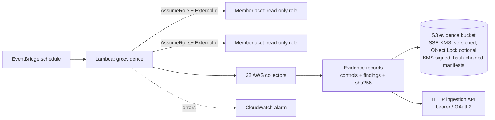

# grc-evidence-automation

[](https://github.com/DustyStudy/grc-evidence-automation/actions/workflows/ci.yml)
[](https://github.com/DustyStudy/grc-evidence-automation/actions/workflows/codeql.yml)
[](LICENSE)
[](https://scorecard.dev/viewer/?uri=github.com/DustyStudy/grc-evidence-automation)
[](https://github.com/DustyStudy/grc-evidence-automation/releases)

**Scheduled, tamper-evident cloud control evidence, mapped to SOC 2, ISO/IEC 27001:2022, NIST SP 800-53 and FedRAMP 20x Key Security Indicators.**

Read-only Python collectors gather configuration evidence from AWS (and optionally GCP), tag each record with the SOC 2 criteria, ISO 27001 Annex A controls, NIST 800-53 controls and FedRAMP 20x KSIs it is relevant to, seal it with a SHA-256, and deliver it on a schedule to an encrypted S3 evidence store and/or a GRC-platform ingestion API. Deploys as a Lambda with Terraform.

**Verified live (an earlier build):** deployed into a member account of a real AWS Organization. A dry run returned 13 control results (5 pass, 7 fail, 1 not applicable), the real run delivered sealed evidence to S3, and `grc-evidence verify` confirmed every hash. That run predates the signing, hash-chain, FIPS and newer collector work, which are covered by unit tests only. The first `terraform apply` exposed a reserved-concurrency bug, now configurable. [Evidence](docs/live-deployment-verification.md).



Built for the "evidence, not screenshots" problem: a crosswalk in the spirit of FedRAMP control mapping, applied to the SOC 2 / ISO 27001 world where an auditor samples evidence over a period. `NIST 800-53` is included so an existing 800-53 control set maps straight across, and `fedramp_20x` maps the same evidence to the 46 [FedRAMP 20x Key Security Indicators](https://github.com/FedRAMP/rules) (Consolidated Rules 2026.09.13.02).

## What you get

| | |
|---|---|
| **24 collectors** | 22 AWS: IAM (MFA, password policy, access-key hygiene, admin principals), S3 exposure and encryption, CloudTrail, KMS rotation, EBS/RDS encryption, security-group exposure, GuardDuty/Security Hub, AWS Config, VPC flow logs, backups, ACM certificates, EKS, Identity Center, Secrets Manager rotation, Inspector vulnerability scanning, WAF; 2 GCP: Cloud Storage and firewall exposure (CLI only, see [Limitations](#limitations)). Each collector needs the read actions listed in the Terraform reader role, so re-apply the reader role in each member account after upgrading. [Reference](docs/collectors.md) |
| **Control crosswalk** | Every collector maps to SOC 2 criteria, ISO 27001:2022 Annex A, NIST 800-53 controls and FedRAMP 20x KSIs, kept in [`collector_map.yaml`](src/grcevidence/data/collector_map.yaml) and validated in CI. |
| **Honest coverage report** | Shows which controls have automated evidence, and which technical controls are gaps. Organizational controls (policies, board oversight, HR) are marked as outside what any collector can prove. The percentages are over the controls this tool maps (a curated subset of each catalog, for example the 22 NIST 800-53 controls the collectors reference), not over the full SOC 2, ISO 27001 or NIST 800-53 catalogs. [SOC 2 / ISO / NIST coverage](docs/coverage.md) |
| **Integrity** | Every record carries a SHA-256, and the run manifest that lists them is signed with an asymmetric KMS key and hash-chained to the previous run. `grc-evidence verify` detects edited, missing and extra files, invalid signatures, and deleted, reordered or rewritten past runs. Signing happens only when a `signing:` key is configured (the Terraform module enables it by default). Without `grc-evidence verify --key-id`, a writer to the store can re-hash and re-sign history with its own key, so the tamper-evidence claim holds only when verify pins the key. Paired with S3 Object Lock in `COMPLIANCE` mode, written evidence can't be changed or deleted at all for the retention period. [What each layer does and doesn't stop](docs/ARCHITECTURE.md#integrity-and-threat-model). |
| **Judged against what** | Each manifest records the thresholds (`parameters`), the collectors that ran, the tool version and a hash of the effective config, so a `pass` can be tied to the bar it was judged against. |
| **Failures are visible** | A check that cannot run (denied, throttled, service error, account not assumable) becomes an `error` record, never a silent pass, and an account that cannot be assumed turns every control `error` in the rollup. A run with any error record, or a failed delivery, raises after delivery so the Lambda error alarm fires. A scheduled run that never starts trips a separate missed-run alarm. |
| **Multi-account** | Assumes a read-only role in each member account with an `ExternalId`. Terraform for the collector and for the member-account role. GovCloud/China ARN partitions are handled. |
| **Sinks** | Local files, S3 (SSE-KMS, conditional writes that never overwrite), and a generic HTTP ingestion sink (bearer or OAuth2 client-credentials, retries, idempotency keys, no redirect following). [What to know](#sinks). |
| **Infrastructure** | [Terraform](deploy/terraform): Lambda, EventBridge schedule, KMS-encrypted versioned bucket (Object Lock in `COMPLIANCE` mode by default, with `object_lock_days` required), least-privilege IAM, error and missed-run alarms. |

## Quick start

```bash
pip install -e ".[dev]"

# See what is covered and what is not
grc-evidence coverage
grc-evidence collectors

# Collect from the account your credentials point at, into ./evidence
grc-evidence collect --output ./evidence --regions us-east-1
grc-evidence verify ./evidence
grc-evidence report ./evidence --framework soc2      # or iso27001, nist_800_53, fedramp_20x
```

A collected record ([sample](docs/sample-evidence.json), [sample SOC 2 rollup](docs/sample-report.md)):

```json
{
  "collector": "aws.network_exposure",
  "account": "123456789012",
  "region": "us-east-1",
  "status": "fail",
  "summary": "2 security group(s) examined; 1 expose sensitive ports to the internet",
  "controls": {"soc2": ["CC6.6"], "iso27001": ["A.8.20", "A.8.22"], "nist_800_53": ["SC-7"], "fedramp_20x": ["KSI-CNA-MAT", "KSI-CNA-RNT", "KSI-CNA-ULN"]},
  "findings": [{"resource": "sg-e70e730ea5b4180c0 (legacy-bastion)", "message": "Port 22/tcp open to the internet", "severity": "high"}],
  "schema_version": "2.0",
  "sha256": "a1e541d2de7ba016478033caf62d5ccc8cba9dd007819a0724557f81901e45d3"
}
```

The block above leaves out `provider`, `title`, `collected_at` and `data`, which the hash covers, so it's the hash of the full [sample file](docs/sample-evidence.json), not of these lines.

### Command reference

| Command | Flags | Exit codes |
|---|---|---|
| `collect` | `--config FILE` (YAML; without it: the current credentials' account, `us-east-1`, every collector). `--output DIR` writes to a local directory and replaces the config's sinks. `--only a,b` runs only those collector ids (it replaces `collectors.include`; `exclude` still applies). `--regions a,b` replaces the top-level `regions` (an account's own `regions` list still wins). `--dry-run` collects and prints but builds no sinks and writes nothing. `--fail-on-findings` exits 1 when any record is `fail` or `error`. | `0` delivered. `1` with `--fail-on-findings`, a record is `fail` or `error`. `2` config, input, signing or chain-read error, or no sink configured. `3` a sink failed (reported ahead of `1`). |
| `verify` | `--key-id ARN`, `--skip-signature` (see [Integrity](#integrity-signing-chain-and-verify)) | `0` verified. `1` a problem was found. `2` the input couldn't be read. |
| `report` | `--framework`, `--format markdown\|json`, `--no-verify` | `0` rendered. `1` the run's hashes don't verify, nothing rendered. `2` the input couldn't be read. |
| `coverage` | `--framework`, `--format text\|markdown`, `--check` validates the crosswalk only | `0`, or `1` when `--check` finds a mapping problem. |
| `collectors`, `permissions` | `collectors --format text\|markdown` | `0` |

`report` checks the run's record and manifest hashes before it renders, and refuses a run that fails. `--no-verify` renders it anyway with a warning on stderr. It doesn't check signatures or the chain; that's `verify`. A `--dry-run` with `signing` configured still calls `kms:Sign`, because the manifest is signed before delivery. A bad command line exits 2 (argparse).

## Configuration

```yaml
# grc.yaml   (see examples/config.example.yaml)
accounts:
  - id: "111111111111"
    name: prod
    role_arn: arn:aws:iam::111111111111:role/GrcEvidenceReader
    external_id: 3f9c1c2e-replace-with-a-random-value
    regions: [us-east-1, us-west-2]
regions: [us-east-1]                 # default for accounts without their own list
use_fips_endpoint: true              # default; every AWS call uses FIPS 140 endpoints
collectors:
  exclude: [aws.backups]
parameters:                          # thresholds; set these to YOUR policy
  max_access_key_age_days: 90
  password_min_length: 15             # NIST SP 800-63B-4 single-factor minimum
  sensitive_ports: [22, 3389]
gcp:
  projects: [my-project]             # needs the [gcp] extra and Application Default Credentials
sinks:
  - {type: local, path: ./evidence}
  - {type: s3, bucket: my-evidence-bucket, prefix: evidence, kms_key_id: arn:aws:kms:us-east-1:111111111111:key/...}   # the key ARN; the module's bucket policy denies aliases
  - type: http
    url: https://ingest.example.com/v1/evidence
    format: bundle                   # one POST per run, or per_evidence
    auth: {type: bearer, token: "secretsmanager:grc/ingest-token"}
```

Unknown keys are errors at the top level, in each `accounts` entry, in `collectors`, `parameters` and `signing`, and in the options of an `s3` or `http` sink. Three places aren't checked, so a typo there is silently ignored: extra keys under `gcp`, extra keys inside an HTTP sink's `auth` block, and extra keys on a `local` sink. Secrets are references (`env:`, `secretsmanager:`, `ssm:`). A literal `auth.token`, `auth.client_id` or `auth.client_secret` on any sink is refused when the config is loaded, so `collect`, `collect --dry-run` and the Lambda all stop before anything runs, and the error names the field but never the value. An HTTP sink's `headers` are literal strings and aren't checked, so don't put a credential there. In the Lambda, `ssm:` references work only when their ARNs are passed as `ssm_parameter_arns` (and their KMS keys as `ssm_kms_key_arns`) to the Terraform module.

### Sinks

- **The chain comes from the first `local` or `s3` sink only.** The previous run is read from that one sink, in the order the sinks are listed, and every sink receives the same manifest. A config with only an `http` sink has nowhere to read from, so every run is written as a genesis (`previous: null`) with no warning, and there's no chain to verify. Add an `s3` or `local` sink if you need the chain.
- **`kms_key_id` is required for the Terraform module's bucket.** Without it the S3 sink writes with SSE-S3 (`AES256`), and the module's bucket policy denies any write that isn't SSE-KMS under its own key ARN. A bucket without that policy accepts SSE-S3.
- **The layouts differ.** The local sink writes `<path>/<run_id>/`. The S3 sink writes `<prefix>/dt=YYYY-MM-DD/<run_id>/`, where the date is the run's UTC start date. Each run directory holds one JSON file per record and `manifest.json`, written last. `verify` and `report` read both layouts.
- **S3 writes never overwrite.** Each put is conditional (`If-None-Match: *`), so sending the same run to the same prefix twice fails. Set `expected_bucket_owner: "111111111111"` (quoted) to refuse a bucket of the same name owned by another account.
- **HTTP sink.** `headers` are sent only to the ingest URL, never to the OAuth2 `token_url`, which must be `https`. A URL with userinfo (`user:pass@host`) is rejected. The query string isn't inspected, so don't put a token there; use `auth`.

### Integrity: signing, chain and verify

```yaml
signing:
  kms_key_id: arn:aws:kms:us-east-1:111111111111:key/...   # asymmetric ECC_NIST_P256, SIGN_VERIFY
```

With `signing` set, each run's manifest SHA-256 is signed with `kms:Sign` (`ECDSA_SHA_256`), and the run fails rather than deliver an unsigned manifest. Every run also records the `run_id` and hash of the run before it, read from the first `s3` or `local` sink before sealing. If that read fails, the run fails, so a chain break can't hide behind a false "first run". The collector needs `s3:ListBucket` on the evidence prefix, `s3:GetObject` on its `manifest.json` objects, and `kms:Sign` on the key. The Terraform module grants exactly that.

```bash
grc-evidence verify ./evidence                     # every run under the directory, and the chain between them
grc-evidence verify ./evidence/<run_id>            # one run: hashes and signature
grc-evidence verify s3://my-evidence-bucket/evidence --key-id <signing_key_arn>
```

`--key-id` pins the key that must have signed every run. An unsigned run fails, a run signed with any other key fails, and a store with no signed run fails. Without it, `verify` checks each signature against the key named in the manifest, says the key wasn't pinned, and counts unsigned runs. That checks consistency but doesn't prove where the runs came from, so auditors should always pin. `--skip-signature` checks hashes and the chain only, for when you have no KMS access. Manifests written before schema 2.0 are reported as legacy and don't fail. Read [the threat model](docs/ARCHITECTURE.md#integrity-and-threat-model) before relying on this: a hash alone stops nothing deliberate, and the collector's own role can sign.

**The signing key.** It is an asymmetric KMS key, and KMS can't rotate asymmetric keys automatically, so the same key signs for the life of the store. `verify` checks signatures by calling `kms:Verify`; there's no offline check. If the key is deleted (or disabled), every past signature becomes unverifiable. The Terraform module sets `prevent_destroy` on it, so Terraform refuses to delete it, but that doesn't stop a deletion made in the console or the API.

**What an auditor needs for `verify s3://bucket/prefix --key-id <arn>`:** `s3:ListBucket` on the bucket (for the evidence prefix), `s3:GetObject` on the objects under it, and `kms:Verify` on the signing key. Those are the only calls the command makes. Because the module's bucket is SSE-KMS, S3 also requires `kms:Decrypt` on the evidence key to return the objects. With `--skip-signature` no KMS signing-key access is needed. The command downloads every object under the prefix to a temporary directory. [Details](docs/ARCHITECTURE.md#auditor-access-for-verify).

#### Auditor access

The Terraform module can grant that access. `auditor_principal_arns` (default `[]`) takes IAM principal ARNs: roles, users or an account root. For those principals only, it adds:

- `s3:GetObject` on `evidence/*` and `s3:ListBucket` limited to the `evidence/` prefix, in the bucket policy;
- `kms:Decrypt` on the evidence key, only when the call comes through S3 in the stack's region (`kms:ViaService`);
- `kms:Verify` and `kms:GetPublicKey` on the signing key.

An empty list adds no statements. The grants are read-only and the bucket's TLS and encryption denies still apply. A principal in another account also needs the same actions allowed by IAM in its own account. These policies pass `terraform validate` and a test that checks each grant is opt-in; they have not been exercised against a live account, and the `kms:ViaService` condition is untested against real S3. See [deploy/terraform/README.md](deploy/terraform/README.md).

### FIPS endpoints

`use_fips_endpoint` (default `true`) makes the AWS clients use FIPS 140 validated endpoints: collectors, STS role assumption, the S3 sink, and `secretsmanager:`/`ssm:` secret lookups. Not every service has a FIPS endpoint in every region, and only the clients covered by the FIPS unit tests are verified; check the endpoints for your regions before relying on this for a FedRAMP boundary. Configure only US regions in `regions`; nothing enforces this. The HTTP sink's TLS and the SHA-256 hashing run on the Python runtime's OpenSSL, which this project does not claim is FIPS-validated.

One call needed a workaround: in the commercial partition, S3's `ListBuckets` has no FIPS endpoint (the bare `s3-fips.<region>` hostname has no address records; only per-bucket hostnames exist). With FIPS on, `aws.s3_security` lists buckets through the Cloud Control API (`cloudcontrolapi-fips`) in every enabled US region and merges the results. A US region it can't reach over FIPS becomes a MEDIUM finding (`regions_not_enumerated`), not a silent gap. Enabled non-US regions are listed in `regions_out_of_scope`, and they're neither queried nor findings. Keep them locked down with a region-restricting SCP. In GovCloud, `ListBuckets` has a FIPS endpoint and is used directly.

## Deploy

```bash
python -m pip install --require-hashes -r requirements/requirements-dev.txt   # the hash-locked build backend; the zip is built without build isolation
python scripts/build_lambda.py                      # dist/grc-evidence-lambda.zip (Linux wheels for the Lambda runtime)
```

The zip's one third-party dependency (PyYAML) is installed from `requirements/requirements-lambda.txt` with `--require-hashes`, and the zip is reproducible: the same sources give the same bytes.

```hcl
module "grc_evidence" {
  source           = "./deploy/terraform"
  lambda_zip_path  = "dist/grc-evidence-lambda.zip"
  schedule_expression = "cron(0 6 * * ? *)"
  object_lock_days = 365                            # required, no default; 0 turns Object Lock off. Set when the bucket is created
  object_lock_mode = "COMPLIANCE"                   # the default; no one, including root, can shorten or remove it
  evidence_expiration_days = 730                    # must not be shorter than object_lock_days
  # enable_signing defaults to true: an ECC_NIST_P256 KMS key signs every run manifest
  target_role_arns = [module.reader_prod.role_arn]
  alarm_actions    = [aws_sns_topic.security.arn]   # required, no default; [] is allowed but notifies nobody
  collector_config = {
    regions  = ["us-east-1"]
    accounts = [{ id = "111111111111", role_arn = module.reader_prod.role_arn, external_id = var.external_id }]
  }
}

module "reader_prod" {                               # applied in each member account
  source           = "./deploy/terraform/reader_role"
  trusted_role_arn = module.grc_evidence.function_role_arn
  external_id      = var.external_id
}
```

Invoke once with `{"dry_run": true}` to check that the collectors can read their resources. A dry run builds no sinks, so it does not test `s3:PutObject`, the chain read, or secret lookups, and it logs counts only, not which collector failed. Before the first schedule, run a real invocation against a test prefix and check the delivered objects. The IAM policy is exactly the read-only action list the collectors use; `grc-evidence permissions` prints it and a test fails if the Terraform drifts from it. See [deploy/terraform/README.md](deploy/terraform/README.md). For a real deployment into a live AWS account, proving the module, the Lambda and the S3/KMS delivery path all actually work, plus a real deployability bug it found and fixed, see [`docs/live-deployment-verification.md`](docs/live-deployment-verification.md).

### Lambda reference

- **Configuration** is the `GRC_CONFIG` environment variable: JSON, same schema as the YAML file. The module builds it from `collector_config`, adds the S3 sink, `extra_sinks`, `use_fips_endpoint` and the signing key.
- **Event keys.** `{"collectors": ["aws.cloudtrail"]}` runs only those collectors for that invocation. `{"dry_run": true}` collects and writes nothing. `{"config": {...}}` is rejected unless the function has `GRC_ALLOW_EVENT_CONFIG=true`; leave that off. The scheduled event carries none of these.
- **Config size.** Lambda limits all of a function's environment variables to 4 KB in total and rejects a function whose variables are larger. The module checks this itself: a precondition fails the Terraform run when the serialized `GRC_CONFIG` is 4096 bytes or more. It counts the value only, so the real limit can be a few bytes lower. `GRC_CONFIG` is the only place the handler reads its configuration from, so a large multi-account config has to be made smaller: lean on the top-level `regions` and the defaults, or split the accounts across more than one deployment.
- **Sink secrets in `extra_sinks`.** A literal `auth.token` or `auth.client_secret` fails variable validation; use an `env:`, `secretsmanager:` or `ssm:` reference. The function's config load also rejects a literal `auth.client_id`.
- **Auditor access.** Set `auditor_principal_arns` to the IAM principals that should read evidence and verify signatures. It is empty by default and then adds nothing. See [Auditor access](#auditor-access).
- **Timeout and memory** are fixed in the module at 900 seconds (the Lambda maximum) and 512 MB. Collectors run one after another, so run time grows with accounts × regions × regional collectors (global collectors run once per account). Evidence is delivered only after every collector has finished: a run that hits the timeout writes nothing and shows up as a Lambda error. Size the account list per deployment with that in mind, and time a real run before scheduling.
- **A failed run** (a sink failure, or any `error` record) raises after delivery so the error alarm fires. It is not retried; the next scheduled run is the retry.

## Delivering to a GRC platform

The HTTP sink is intentionally vendor-neutral. It POSTs this project's JSON schema to a URL you configure and handles auth, retries, idempotency and safe redirect behaviour. GRC platforms differ in endpoint and payload shape, so you either wrap fields with `payload_template` or put a small adapter in front. **The sink has not been verified against any specific vendor's API**; see [docs/INGESTION.md](docs/INGESTION.md) for the contract and what to check before pointing it at one.

## What automated evidence does and does not do

- It shows configuration state at collection time, over time, with integrity protection. That is useful audit evidence for *technical* controls.
- It does **not** establish that a control is effective or that you are compliant. Auditors decide that, and for SOC 2 they choose the criteria in scope. Mapping a collector to a criterion means "relevant to", not "satisfies".
- Organizational criteria (governance, HR, vendor management, incident response) need documents and records outside any cloud API. They are listed in the coverage report as such.
- Thresholds (key age, password length, backup retention) default to common benchmark values. Set them to what your policy says, because that is what gets tested.
- The FedRAMP 20x mapping is *relevant-to* evidence for the machine-checkable part of a KSI. It is not a FedRAMP authorization artifact, is not in FedRAMP's machine-readable submission format, and does not replace validation by FedRAMP or an assessor. Which KSIs apply depends on your Certification Class, and FedRAMP revises the KSI set, so the catalog pins the version it was built from.
- Control titles are short paraphrases, not the standards' text. Check the crosswalk with your auditor before relying on it.

## Limitations

- GCP collectors run from the CLI only. The Lambda artifact doesn't package the google-cloud libraries, and the handler refuses a config with `gcp.projects`.
- GCP collectors are unit-tested against fakes shaped like the `google-cloud-storage` / `google-cloud-compute` objects and have not been run against a live project by this repo's CI.
- `aws.iam_privileged_access` reports three things: administrator-equivalent principals, `iam:PassRole` on all roles (HIGH), and risky role trust policies (HIGH when any AWS principal can assume the role and the statement has no Condition, MEDIUM when another account can assume it without an `sts:ExternalId` condition). What it still doesn't do:
  - It doesn't subtract explicit Deny statements or evaluate SCPs, resource control policies or permissions boundaries. Conditions are recorded, not evaluated: a `PassRole` grant with a Condition is still HIGH, any Condition at all silences the wildcard-trust finding, and `sts:ExternalId` is checked for presence only.
  - `PassRole` is reported only when it covers every role, and only on the user, group or role that holds the policy. Members of a group that holds it aren't listed. Administrator-equivalent principals and service-linked roles aren't reported for it.
  - Trust policies are checked for wildcard and other-account AWS principals only. Service and federated (SAML, OIDC) principals aren't judged, and it doesn't work out who can reach a trusted principal. A trust statement that uses `NotPrincipal` with no Condition is reported as a wildcard trust.
  - Login-profile actions aren't treated as escalation paths.
- `aws.network_exposure` judges security-group rules for all protocols (`-1`), TCP and UDP. TCP and UDP are judged separately, and other protocols (ICMP, for example) aren't checked. It parses source ranges with Python's `ipaddress` and collapses them per IP family, so a non-canonical form (`0::/0`) or a range split into halves (`0.0.0.0/1` plus `128.0.0.0/1`) counts as internet-open. A range that covers most of the internet but not all of it isn't flagged.
- `gcp.firewall_exposure` is still TCP-only: it reports `all` protocols and TCP (`tcp` or protocol `6`) on sensitive ports, and a UDP rule open to the internet isn't a finding. It sees the same internet-wide source forms as the AWS check: `0.0.0.0/0`, `::/0`, non-canonical forms and split ranges within one rule. It doesn't pool ranges across rules, and a range that covers most of the internet but not all of it isn't flagged.
- The Lambda execution role's trust policy has no `aws:SourceAccount` or `aws:SourceArn` condition (confused-deputy protection). It was left out on purpose: the AWS documentation checked doesn't confirm that Lambda populates either key when it assumes an execution role, and a condition on a key that isn't populated would stop the function from starting.
- The hash chain can fork if two runs overlap against one store: both link to the same predecessor and `verify` reports it. Keep the Lambda's reserved concurrency at 1 and don't run `collect` in parallel against one store. See [Lambda concurrency](docs/ARCHITECTURE.md#decisions).
- The chain is read from the first `local` or `s3` sink only; an HTTP-only config has no chain (see [Sinks](#sinks)).
- AWS collectors are tested against [moto](https://github.com/getmoto/moto). moto does not model everything (for example `GetBucketPolicyStatus` evaluation), so those paths use stub clients.
- Resource inspection is capped per collector per region (`max_items_per_check`, default 500) and records say when they were truncated.
- Single-region checks use the region list you configure; add every region you use, including ones you think are empty (GuardDuty and Config gaps live there).
- No auto-remediation. This tool observes only.
- The FIPS bucket listing (Cloud Control API) is unit-tested with stub clients: moto does not serve FIPS hostnames or the Cloud Control API.

## Development

```bash
pip install -e ".[dev]"
ruff check src tests fuzz scripts && ruff format --check src tests fuzz scripts
mypy src
pytest --cov=grcevidence
terraform -chdir=deploy/terraform fmt -check -recursive
```

Regenerate docs after changing collectors or the crosswalk:

```bash
grc-evidence coverage --format markdown > docs/coverage.md
grc-evidence collectors --format markdown > docs/collectors.md
```

Tests fail if these are stale.

CI also runs `security-scan.yml`: Gitleaks over the full history, Checkov
against the Terraform (blocking), and Trivy for vulnerable dependencies
and misconfigurations (reported to the Security tab). Accepted Checkov
findings are skipped inline in `deploy/terraform/main.tf` with the reason. See [CONTRIBUTING.md](CONTRIBUTING.md), [SECURITY.md](SECURITY.md) and [docs/ARCHITECTURE.md](docs/ARCHITECTURE.md).

## Project health

The [OpenSSF Scorecard](https://scorecard.dev/viewer/?uri=github.com/DustyStudy/grc-evidence-automation) badge reflects a young, solo-maintained project. Code-Review and Contributors need other people, and Maintained scores 0 for any repository under 90 days old. The checks about the code and supply chain (pinned dependencies, fuzzing, signed releases, token permissions, SAST, vulnerabilities) are the informative ones. `codeql-action` is pinned to a full commit SHA like every other action, and Dependabot proposes its updates.

## License

MIT
